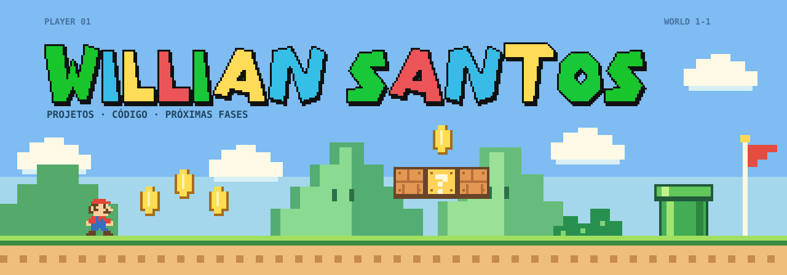

  

<h1 align="center">🎮 Olá, eu sou o Willian Santos!</h1>

  Bem-vindo ao <strong>Willian World</strong>. 
  Meus projetos, experiências e próximas fases no mundo do código.

  <a href="https://github.com/willianas1?tab=repositories">🗺️ Explorar projetos</a>
  &nbsp; · &nbsp;
  <a href="https://www.linkedin.com/in/willian-santos-3814415a/">💬 Conversar no LinkedIn</a>

## 🗺️ Seleção de fases

| Fase | Projeto | Linguagem no repositório |
| :--- | :--- | :--- |
| 🍄 1-1 | [jogo-dinossauro-mario](https://github.com/willianas1/jogo-dinossauro-mario) | JavaScript |
| ⭐ 1-2 | [counter-strike-1.6](https://github.com/willianas1/counter-strike-1.6) | JavaScript |
| 🪙 1-3 | [usage-ia-cockpit](https://github.com/willianas1/usage-ia-cockpit) | C# |
| 🏰 1-4 | [agente-requisitos-suporte](https://github.com/willianas1/agente-requisitos-suporte) | — |

## 🚩 Próximas missões

- [x] Criar meu repositório de perfil.
- [ ] Publicar o visual do Willian World.
- [ ] Escolher um projeto para apresentar com demonstração e instruções de uso.
- [ ] Compartilhar um aprendizado em um projeto público.

Missões pessoais, atualizadas manualmente conforme cada etapa for concluída.

## 🐍 Fase bônus · trilha de contribuições

Cada contribuição faz parte da jornada. A cobrinha percorre meu histórico e coleta os quadradinhos pelo caminho.

<picture>
  <source media="(prefers-color-scheme: dark)" srcset="https://raw.githubusercontent.com/willianas1/willianas1/output/github-snake-dark.svg" />
  <source media="(prefers-color-scheme: light)" srcset="https://raw.githubusercontent.com/willianas1/willianas1/output/github-snake.svg" />
  
</picture>

Uma fase de cada vez. 🍄

<!-- A animação aparece após a primeira execução do workflow snake.yml. Veja PERSONALIZAR.md. -->
